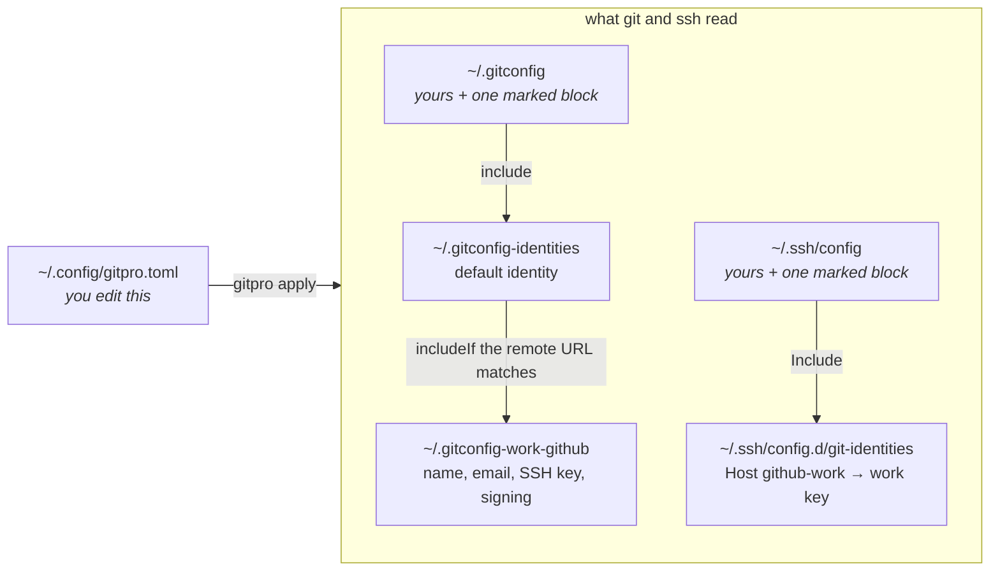

# gitpro

Every repo gets the right git name, email, SSH key and commit signature, chosen
by the repo's **remote URL**. You describe your identities in one TOML file.


Where a repo sits on disk makes no difference.

## Install

Requires Linux or macOS, **git 2.36+**, Python 3.9+ and OpenSSH.

```sh
pipx install git+https://github.com/sandeepshelke/gitpro.git
```

This installs a `gitpro` command.

## Quick start

```sh
gitpro init              # create ~/.config/gitpro.toml from a commented example
$EDITOR ~/.config/gitpro.toml
gitpro keys --generate   # optional: create SSH keys that don't exist yet
gitpro plan              # show every change as a diff
gitpro apply             # write the changes
gitpro keys              # public keys to add to each account
gitpro scan              # every repo under ~ and the identity git uses there
```

`plan` and `apply` refuse to run until you have replaced the example's
placeholder emails and hosts.

## How it works

`apply` turns the TOML into plain git and ssh config. git does the matching
itself, so nothing from this tool runs when you use git.



- In `~/.gitconfig` and `~/.ssh/config` it manages only a block between
  `# BEGIN gitpro` and `# END gitpro`, and leaves the rest
  alone. The first time it changes a file you wrote, it saves a copy as
  `<file>.bak.<timestamp>`.
- The other files are fully generated. Edit the TOML, not them.
- With `sign = true` it also writes `~/.config/git/allowed_signers`, so git can
  verify your own signatures.
- Running `apply` again changes nothing. `uninstall` removes everything it wrote.

## Configuration

```toml
[default]                          # repos that no identity matches
name = "Jane Doe"
email = "jane@personal.dev"
ssh_key = "~/.ssh/id_ed25519"
ssh_hosts = ["github.com"]         # use ssh_key for these hosts
sign = true                        # SSH-sign commits and tags

[[identity]]
id = "work-gitlab"
name = "Jane Doe"
email = "jane.doe@employer.com"
host = "gitlab.employer.com"
owners = ["platform"]              # GitLab groups/subgroups; omit to match the whole host

[[identity]]
id = "work-github"
name = "Jane Doe"
email = "jane.doe@employer.com"
host = "github.com"
owners = ["janedoe-employer", "employer-org"]   # the account and its orgs
ssh_key = "~/.ssh/id_ed25519_work"
ssh_alias = "github-work"
```

`[default]`: every key is optional.

| key | |
|---|---|
| `name`, `email` | Identity for repos no `[[identity]]` matches. Leave both out and git refuses to commit there ("Please tell me who you are"). |
| `ssh_key` | Key used for `ssh_hosts`, and for signing. |
| `ssh_hosts` | Hosts where ssh always uses `ssh_key`. |
| `sign` | `true`: sign commits and tags with SSH keys. Default `false`. |

`[[identity]]`: `id`, `name`, `email` and `host` are required.

| key | |
|---|---|
| `id` | Short name. Its settings go to `~/.gitconfig-<id>` (change with `file`). |
| `host` | Git server, e.g. `github.com`. |
| `owners` | Users, orgs or groups in the remote URL path, **exact case**. Omit to match the whole host. |
| `ssh_key` | This identity's own key. |
| `ssh_alias` | ssh `Host` that offers only `ssh_key`. Without it, if `host` is in `[default].ssh_hosts`, ssh falls back to `[default].ssh_key`, so an unregistered `ssh_key` signs you in as the default account. |
| `rewrite` | With `ssh_alias`, `git@<host>:<owner>/…` URLs go through the alias. Default `true`. |
| `rewrite_https` | Also send `https://<host>/<owner>/…` over SSH through the alias. Default `false`. |
| `ssh_user`, `ssh_port` | For a non-standard SSH user or port. Default `git`, 22. |
| `sign` | Overrides `[default].sign`. |

A repo matches an identity when any of its remotes matches. When several
identities match, the settings of the later one win. Any other git setting can
be added under `[default.git.<section>]` or `[identity.git.<section>]`; the
example from `init` shows how.

The config is read from `-c PATH`, else `$GITPRO_CONFIG`, else
`~/.config/gitpro.toml`. Because it controls commands git runs, it must
be owned by you and not group/world-writable.

## Commands

| command | |
|---|---|
| `init [PATH]` | Create the commented example config. Never overwrites. |
| `plan` | Show what `apply` would change, as diffs. |
| `apply [-y]` | Write the changes. It asks first; `-y` skips the question and is required without a terminal. |
| `check` | Exit 1 if `apply` would change anything. |
| `keys [--generate]` | List each SSH key, its public key and where to register it. `--generate` creates the missing ones. |
| `which [DIR]` | Show the identity git uses in a repo, and which file each setting comes from. |
| `scan [--fix] [--suggest] [DIR…]` | Find the repos under each `DIR` (default `~`) and list them by the identity git uses. `--fix` removes [repo-level overrides](#repo-level-overrides); `--suggest` prints identities that would keep them. |
| `pin [DIR]`, `unpin [DIR]` | Copy the repo's name and email into its `.git` directory, for [dev containers](#dev-containers). `unpin` removes it. |
| `uninstall [-y]` | Remove everything `apply` wrote. Keeps your config and SSH keys. Pinned repos stay pinned. |

## Example: a second GitHub account

1. Add an `[[identity]]` with `host = "github.com"`, the account and its orgs as
   `owners`, its own `ssh_key` and an `ssh_alias` (as in the example above).
2. Run `gitpro keys --generate`, then `gitpro apply`.
3. Add the public key that `gitpro keys` prints to that account under
   *Settings → SSH and GPG keys*. With `sign`, add it a second time as a
   *Signing key*.
4. Check with `ssh -T git@github-work`. GitHub replies with the account name.
5. Clone as usual: `git clone git@github.com:employer-org/app.git`.

## Repo-level overrides

A `user.name` or `user.email` in a repo's own `.git/config` wins over gitpro,
so an old one keeps committing with an old address. `gitpro scan` lists them,
grouped by the identity they'd use without the override:

```text
2 repos set their own user.name/user.email, which beats gitpro. Without it they use:

Jane <jane@personal.example>  (2 repos)
├── from Jane <old@personal.example>:  app
└── unchanged: tools
```

`gitpro scan` changes nothing. `gitpro scan --fix` removes the overrides. If
gitpro was installed with the `tui` extra
(`pipx install 'gitpro[tui] @ git+https://github.com/sandeepshelke/gitpro.git'`),
it opens a list where you tick the repos to fix. Without the extra, or with
`--plain`, it asks y/N. Either way it saves an undo script under
`~/.local/state/gitpro/` and prints the command to run it. It keeps any
override whose removal would leave the repo with no identity.

To keep a repo's current identity instead, add a gitpro identity for it before
fixing. `gitpro scan --suggest` prints a ready-to-paste `[[identity]]` block
for each such identity (in the list: press `s`). Paste the ones you want into
your config and run `gitpro apply`. An identity applies to every repo of its
owners, so each block says how many other repos it would change. gitpro never
edits your config itself.

Name directories to scan only the repos under them (`gitpro scan ~/work`),
or `--repo PATH` for exactly one repo. `-v` adds full paths and the remote
owners behind each identity. `--json` is for scripts and the VS Code extension.

## Dev containers

VS Code Dev Containers copy `~/.gitconfig` into the container, but not the
files it includes, so no identity applies inside. The same happens when a
container mounts only `~/.gitconfig`. Fix it per repo, on the host:

```sh
gitpro pin    # in the repo
```

This writes the repo's current name and email to `.git/git-identities` and
includes it from `.git/config`. The container sees both because they are part
of the mounted repo. Run `pin` again after you change your config. Commit
signing and the choice of SSH key are not pinned.

## Troubleshooting

- **Wrong or no identity**: run `gitpro which` in the repo and compare
  its remote URL with `host` and `owners`. Owners are case-sensitive.
- **Push or clone signs in as the wrong account**: register the identity's key
  with that account (`gitpro keys`). With an `ssh_alias`, ssh offers only
  that key, so you get an error instead of the wrong account.
- **One repo ignores the config**: a repo-level `user.email` overrides it.
  `gitpro scan DIR` shows it; `gitpro scan --fix DIR` removes it.

## Development

```sh
python -m venv .venv && .venv/bin/pip install -e . pytest && .venv/bin/pytest
```

## License

MIT
